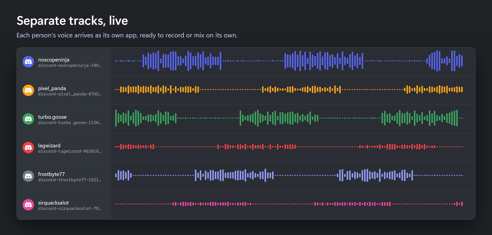

# VoiceStreams

A Vencord plugin for Windows that plays each person in your Discord call from their own app, so
they get their own entry in the volume mixer and can be recorded separately.

## Setup

1. Install [Vencord](https://vencord.dev/download/) and open Discord once.
2. Download and run the
   [Vencord Plugin Installer](https://github.com/CalvBot/vencord-plugin-installer/releases/latest),
   tick **VoiceStreams** and click Install.

It builds Vencord with the plugin on your own PC and switches it on. Run it again to update.

To build it yourself, copy `src` into a Vencord source checkout as `src/userplugins/voiceStreams` and
build Vencord.

People with "Allow Clips" off run from `%LOCALAPPDATA%\VoiceStreams\clips-off\`, everyone else from
`clips-on\`, so your recorder can skip them.

Uses undocumented Discord internals, so a Discord update can break it.
